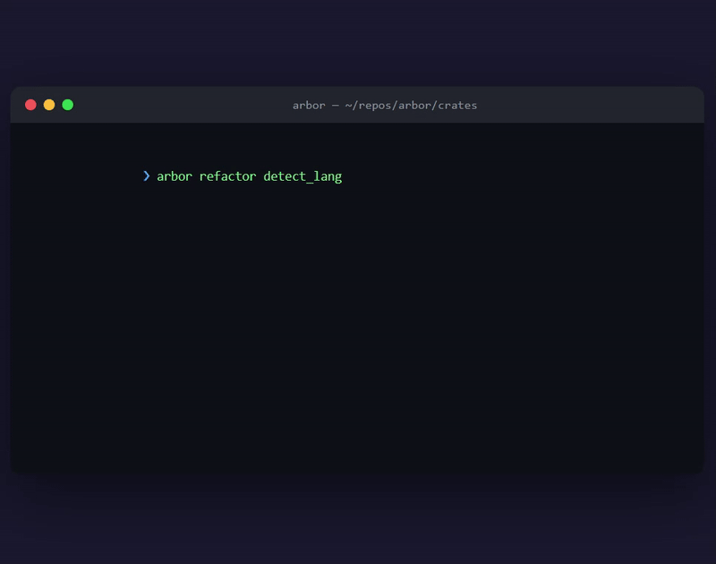
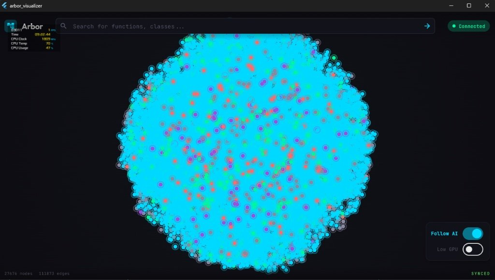

<p align="center">
  <picture>
    <source media="(prefers-color-scheme: dark)" srcset="docs/assets/arbor-lockup-dark.svg" />
    <source media="(prefers-color-scheme: light)" srcset="docs/assets/arbor-lockup-light.svg" />
    
  </picture>
</p>

<p align="center">
  <strong>Code context for people and agents.</strong><br>
  Find a function&rsquo;s callers. Trace the path through your code.<br>
  Know what breaks <em>before</em> you break it.
</p>

<p align="center">
  <a href="https://github.com/Anandb71/arbor/actions"></a>
  <a href="https://crates.io/crates/arbor-graph-cli"></a>
  <a href="https://github.com/Anandb71/arbor/releases"></a>
  <a href="https://github.com/Anandb71/arbor/pkgs/container/arbor"></a>
  <a href="https://glama.ai/mcp/servers/@Anandb71/arbor"></a>
  
</p>

<p align="center">
  
</p>
<p align="center">
  <sub>Simulated replay — the <code>arbor</code> commands and their output are real (tokio @ 178k LOC). Methodology: <a href="docs/BENCHMARKS.md">BENCHMARKS.md</a></sub>
</p>

> **v3.1.0** · Find code that calls retiring AI models: `arbor retirements` lists the direct OpenAI, Anthropic and Google SDK calls in a Python project that use a retired or retiring model, with the listed replacement and what has to change, locally or as a GitHub Action. `arbor usages` and the MCP tool `find_api_usages` list every such SDK call with its routing and model. [Release notes](docs/RELEASE_NOTES_v3.1.0.md)

---

## Why Arbor

Most AI coding tools treat code as text. Arbor builds a **semantic dependency graph** — functions, classes, and modules as nodes; calls, imports, and inheritance as edges — then answers execution-aware questions with deterministic precision:

| Question | Arbor answer |
|----------|--------------|
| *If I change this symbol, what breaks?* | Blast radius with depth, confidence, and risk level |
| *Who calls this — directly and transitively?* | Caller/callee traversal on the call graph |
| *What's the shortest path between A and B?* | A* path through real dependencies |
| *Is this PR too risky to merge?* | CI gate on blast-radius thresholds |

No keyword guessing. No embedding hallucinations. One graph, every interface.

Where the graph is *unsure*, it says so — edges carry a confidence, and ambiguous resolutions are labelled rather than hidden. An honest unknown beats a confident wrong answer.

---

## What's new in v3.1.0

A feature release: two commands for Python code that calls AI model APIs. Both run
locally, with no account, API key or telemetry.

| New | What it does |
|-----|--------------|
| **`arbor retirements`** | Lists the direct `openai`, `anthropic` and Google SDK calls that use a model its provider has retired or is retiring: the date, the replacement the provider lists, the arguments that change with it and the choices your repo makes first. OpenAI shuts down `gpt-4o`, `gpt-4o-mini`, `gpt-4.1` and `gpt-4.1-mini` on 14 January 2027. [More below](#find-code-that-calls-retiring-ai-models) |
| **GitHub Action `mode: retirements`** | The same check in CI: a job summary that lists every affected call, and warnings on the most urgent lines. It warns by default and fails the build only when you set `retirements-fail-on`, or when the check cannot run. |
| **`arbor usages` and `find_api_usages`** | Every OpenAI, Anthropic and Gemini SDK call with its file and line, client routing (direct, Azure, custom `base_url`, Bedrock, Vertex) and model IDs, for people and agents. A value is confirmed only inside a small supported grammar; everything else carries a typed gap. [What a report confirms](docs/SDK_USAGES.md) |

Python only for now; graph extraction is unchanged (a saved graph is rebuilt
once on first use, as after every upgrade). See the
[3.0.5 release notes](docs/RELEASE_NOTES_v3.0.5.md) for the previous release.

<details>
<summary><strong>v3.0.3</strong> (Rust calls through paths and macros, per-symbol diff, <code>--base</code>)</summary>

A fix release. Every item below was a wrong answer, not a missing feature, and
each ships with a regression test.

| Fix | What was wrong |
|-----|----------------|
| **Rust calls resolve** | `crate::jobs::enqueue()`, `Type::new()`, `self.helper()` and calls inside `assert!`/`format!` produced no edge, so heavily used Rust functions reported no callers. Paths now resolve through the module tree, and macro arguments are read as code. |
| **Per-symbol `arbor diff`** | Every symbol in a touched file counted as changed, so adding a function to a busy file reported that file's whole blast radius. New symbols now carry none; only modified ones do. Tests that call the change are listed as worth running, not counted as impact. |
| **`--base` and `--staged`** | `arbor diff`, `check` and `summary` saw only uncommitted edits unless `ARBOR_DIFF_BASE` was set. `--base origin/main` compares against the merge base, which is what a pull request shows; `--staged` checks just what is staged. |
| **Languages stay apart** | A TypeScript `enqueue` could be reported as a caller of a Rust `enqueue`. Resolution stays within a language family, and `callers`/`callees` list each same-named definition separately. |
| **No stale graphs** | After a branch switch, answers came from the old branch's graph when no remaining file was newer than it. The graph now records the commit it was built from and refreshes when `HEAD` moves. |
| **Inheritance edges** | `class Middle(Base)` produced no edge, so changing a base class showed zero blast radius. `extends`/`implements` edges are emitted and inherited methods stay reachable. |
| **Call cycles rank as one** | A closed ring of functions filled the top of every centrality ranking. Cycles are condensed before PageRank. |
| **HTTP bridge hardening** | `arbor bridge --http` accepted cross-origin and DNS-rebinding requests. It now checks `Origin`/`Host` and requires JSON bodies. |
| **Quieter bridge** | The bridge re-indexed ignored build directories in a busy loop. |

Also new: [`arbor receipt`](docs/RECEIPTS.md). After each coding-agent turn it
explains, in plain English, what changed and what was touched that you didn't
ask for, with `arbor receipt undo` to put a turn back.

Cached graphs from 3.0.0 are rebuilt automatically on first use.

</details>

<details>
<summary><strong>v3.0.0 — The Right Node</strong> (symbol resolution consults the importing file)</summary>

One fix, measured.

**Symbol resolution consults the importing file.** When a bare name matched
definitions in several modules, `resolve_ref` fell through to `SameDir` and
attached the edge to whichever definition sat in the caller's own directory —
not a dropped edge, a confidently misrouted one, stamped at 0.55 confidence.

`GraphBuilder` already kept a per-file import map, but only
`apply_import_validation` read it, and that scores an edge *after* one has been
chosen. It never saw the references going to the wrong node. Consulting it
between the same-file and same-directory checks keeps a local definition
shadowing an import, while letting a written import beat mere adjacency.
`Resolution::ViaImport` scores 0.93, above `SameDir`'s 0.55.

### Measured

A fixture of 260 modules across 10 layers, each layer defining the same 26
function names. Ground truth is derived from the generator's own edge list, so
the expected answer is exact rather than estimated.

| True downstream | v2.6.0 | v3.0.0 |
|---|---|---|
| 179 | 0 | **163** |
| 178 | 0 | **161** |
| 161 | 0 | **133** |
| 143 | 22 | **133** |
| 122 | 22 | **119** |
| 36 | 22 | 61 |
| 16 | 22 | 46 |

Previously flat at about 22 regardless of the real answer. Now it tracks. Risk
on the largest hub moves from `LOW` to `CRITICAL`.

Total edge count barely moves (1335 → 1334). That is the signature of
misrouting rather than loss: the edges were always there, pointing at the wrong
nodes.

### Breaking

- `Resolution` gains a `ViaImport` variant — an exhaustive match will not compile
- Edges land on different nodes, so cached graphs, stored node ids, and
  centrality baselines from 2.6.0 will differ

Call cycles are condensed before PageRank. Each strongly connected component is ranked once and that mass is shared across its members, so a closed ring does not fill the top of the ranking and a cycle that calls out keeps its members together. The number `CentralityScores` reports is still the v2.6.0 percentile, `i / (n - 1)`.

### Known and still open

Written down rather than left to be discovered:

- Small targets now **over**-report (36 → 61, 16 → 46). Safer direction than
  silence, but not yet correct.
- Dynamic and reflective imports (`importlib`, `__import__`, `import()`,
  `eval(require(...))`) are unresolvable by construction and are documented as
  expected misses in the fixture rather than counted as defects.

</details>

<details>
<summary><strong>v2.6.0 — Ground Truth</strong> (colliding symbols kept, deterministic resolution, edge confidence, percentile centrality)</summary>

Correctness, not speed. Each of these was silently wrong before.

| Fix | Why it mattered |
|-----|-----------------|
| **Colliding symbols are kept** | `SymbolTable` used `HashMap::insert`, so a second `handler`, `new`, or `process` replaced the first. The loser had zero callers and was invisible to blast radius. |
| **Resolution is deterministic** | Same-directory locality was decided by iterating a `HashMap`. Rust seeds `RandomState` per process, so the same binary on the same input could build different edges between runs. Now asserted across eight fresh processes. |
| **Edges carry confidence** | A proven same-file call and a same-directory guess were identical evidence. Each edge now scores `[0,1]` by how it resolved. |
| **Exported TS symbols indexed once** | `export_statement` recursed into its children, then the generic loop recursed again — every exported symbol became two vertices sharing one node id. **133 phantom nodes on a 149-file app, 25% of the graph.** |
| **Method calls on untyped receivers resolve** | `obj.method()` was dropped outright, leaving the graph nearly edgeless on TS/JS — and an empty graph reports a blast radius of zero, which reads as "safe" rather than "unknown". |
| **Centrality is a percentile rank** | Scores were divided by the graph maximum, so the top node was `1.0` by construction and a `0.6` threshold meant nothing consistent between repos. Adding one hub rescaled every other node. |
| **Resolution is O(1), not O(refs × nodes × files)** | Unresolvable references — stdlib and third-party calls, most call sites in real code — paid the worst case. Suffixes are now indexed. |

**New capability — concept search.** Substring matching cannot find `get_authenticated` from `login`; they share no substring. Identifiers are now tokenized and expanded through curated concept clusters, and docstrings, signatures, and paths are indexed alongside names. Deterministic, offline, no model. Available on the library as `ArborGraph::search_ranked` (`arbor query` remains literal-substring for now).

**New capability — hunk-level impact.** `changed_node_ids_for_ranges` keeps only symbols whose lines actually changed, instead of every symbol in a touched file.

Measured on identical node sets, after the duplicate-extraction fix:

| Codebase | Before | After |
|----------|--------|-------|
| TypeScript (149 files) | 172 edges | **196** (+14%) |
| Rust (arbor-graph) | 116 edges | **167** (+44%) |

Graph caches from earlier versions are invalidated — centrality now means something different, so a stale cache would be read wrong.

</details>

<details>
<summary><strong>v2.5.0 — The Last Excuse</strong> (PageRank 23x, parallel indexing, warm-start centrality)</summary>

| Change | Measured |
|--------|----------|
| **PageRank rewrite** — flat call-graph adjacency replaces per-iteration traversal | 149.8ms → **6.6ms** on a 10k-node graph (**23x**), verified side-by-side vs the old implementation |
| **Parallel indexing** — parse fans out across all cores, deterministic assembly | Arbor: 253ms → **95ms** · tokio (178k LOC): 2.7s → **1.6s** |
| **Warm-start centrality** — watcher recomputes seed from previous scores | Converges in ~2 rounds after a one-file patch instead of the full 20-iteration budget |
| **Convergence early-exit** | Iteration stops at 1e-9 max delta — the budget is a ceiling, not a sentence |

Think a number is wrong? `cargo bench -p arbor-graph` and prove it: [BENCHMARKS.md](docs/BENCHMARKS.md).

</details>

<details>
<summary><strong>v2.4.0 — The Agent-Native Leap</strong> (MCP <code>2026-07-28</code>, HTTP transport, Tasks, MCP Apps)</summary>

| Feature | What it does |
|---------|--------------|
| **MCP `2026-07-28`** | Stateless `server/discover`, response caching (`ttlMs`/`cacheScope`), dual-version fallback for `2025-03-26` clients |
| **Tasks extension** | `tasks/get` · `tasks/update` · `tasks/cancel` — cold-start indexing returns task handles, not errors |
| **MCP Apps** | Interactive blast-radius graph (`ui://arbor/blast-radius`) and architecture map (`ui://arbor/architecture-map`) inside agent hosts |
| **HTTP transport** | `arbor bridge --http --port 3333` — stateless MCP behind load balancers |
| **Real `get_blast_radius`** | Git-diff-aware impact analysis via shared `arbor-graph::compute_blast_radius` |
| **Pagination** | `offset` / `limit` / `hasMore` on `search_symbols` and `get_map` |
| **Benchmarks** | Criterion suite + CI regression gate — see [BENCHMARKS.md](docs/BENCHMARKS.md) |

</details>

---

## Quickstart

```bash
# Install (crates.io can lag the latest release: see docs/INSTALL.md)
cargo install arbor-graph-cli

# Index your project (one command)
cd your-project && arbor setup

# Explore before you edit
arbor map . --exclude-test          # ranked project skeleton (~1k tokens)
arbor refactor parse_file           # blast radius of changing a symbol
arbor diff                          # impact of uncommitted git changes
arbor diff --base origin/main       # impact of this branch, as its PR shows it

# Wire up your AI agent
claude mcp add --transport stdio --scope project arbor -- arbor bridge
```

**After every turn:** `arbor hook claude` makes Claude Code show a receipt of what it changed, what it touched that you didn't ask for, and what to test. [Receipts →](docs/RECEIPTS.md)

**Agent workflow:** call `get_map` first → `search_symbols` / `get_file_graph` to locate code → `Read` only the target file. [Full MCP guide →](docs/MCP_INTEGRATION.md)

---

## Find code that calls retiring AI models

OpenAI shuts down `gpt-4o`, `gpt-4o-mini`, `gpt-4.1` and `gpt-4.1-mini` on 14 January 2027, and Anthropic and Google retire models on their own dates. `arbor retirements` lists the direct `openai`, `anthropic` and Google SDK calls that use a retired or retiring model. For each one it shows the replacement the provider lists, the arguments that have to change with it, and the choices your repo makes first (such as whether gpt-6-luna should reason). Calls through LangChain, LiteLLM or other wrappers are not checked yet.

```bash
npx @anandb71/arbor-cli retirements .
```

```text
3 calls use models OpenAI shuts down on 14 Jan 2027 (88 days)
  app/chat.py:12  gpt-4o (MODEL, line 8) → gpt-6-luna
                  also change: max_tokens → max_completion_tokens
                  decide: keep reasoning off (add reasoning_effort="none"; keep temperature) or let the model reason (remove temperature)
  app/chat.py:21  gpt-4o-mini (line 22) → gpt-6-luna  fallback of an environment or config lookup: confirm the deployed value
                  decide: keep reasoning off (add reasoning_effort="none") or let the model reason (no change)
                  check: stop and logit_bias are not supported on gpt-6-luna (400).
```

- **Runs locally.** No account, no API key, no telemetry; no code leaves your machine.
- **Honest about confidence.** A literal is confirmed only where the usage scan has no doubt about the call. `os.getenv("MODEL", "gpt-4o")` fallbacks, parameter defaults, class attributes a subclass may override and calls whose routing is not certain are marked *confirm first* with the reason, and fail the check only with `--count-unconfirmed`. Calls through Azure, OpenRouter or a proxy are listed apart (`--include-routed`), because the provider's dates may not apply there; a `base_url` on the provider's own host is a direct call. Models Arbor cannot read, and code it did not analyze, are counted, not hidden.
- **Arbor does not decide for you.** When the replacement behaves differently by design (gpt-6-luna runs at medium reasoning effort by default, so it can reason, where gpt-4o did not; claude-sonnet-5-5 thinks by default, where the Sonnet models it replaces did not), the report shows both options and what each costs, and changes nothing until you choose.
- **CI ready.** `--json`, `--markdown`, `--annotations`, `--markdown-out <file>` and `--fail-within <days>`. Exit code 1 means a confirmed call uses a retired model, or one retiring inside your window; the shutdown day itself counts as retired (UTC).
- **Scope today:** Python with the `openai`, `anthropic` and Google GenAI SDKs. TypeScript and JavaScript are coming.

GitHub Action (warns by default; it fails the build only if you ask it to):

```yaml
      - uses: Anandb71/arbor@v3.1.0
        with:
          mode: retirements
          retirements-fail-on: never   # or: retired, or a number of days such as 90
```

[How it works, the data sources and the full scope →](docs/RETIREMENTS.md)

---

## For AI agents (MCP)

Arbor ships a production MCP server via `arbor bridge`. Stdio is the default; HTTP is opt-in for remote/enterprise.

```bash
# Stdio (Claude, Cursor, VS Code)
arbor bridge

# HTTP (MCP 2026-07-28)
arbor bridge --http --port 3333
```

### Cursor / VS Code

```json
{
  "mcpServers": {
    "arbor": {
      "type": "stdio",
      "command": "arbor",
      "args": ["bridge"]
    }
  }
}
```

Templates: [`templates/mcp/`](templates/mcp/) · Setup scripts: `scripts/setup-mcp.sh` · `scripts/setup-mcp.ps1`

### 17 MCP tools

| Tier | Tools | Use when |
|------|-------|----------|
| **Orientation** | `get_map` | First call — token-budgeted project skeleton ranked by PageRank |
| **Surgical** | `list_entry_points` · `get_callers` · `get_callees` · `search_symbols` · `get_file_graph` · `get_node_detail` | Navigate to a specific symbol or file |
| **Broad** | `get_logic_path` · `analyze_impact` · `find_path` · `get_knowledge_path` | Trace dependencies, blast radius, paths |
| **Agent-native** | `get_blast_radius` · `explain_symbol` · `audit_security` · `get_architecture_overview` · `batch_query` | PR impact, onboarding, security audit, bulk lookup |
| **SDK usage** | `find_api_usages` | Where the code calls the OpenAI, Anthropic or Gemini SDKs, with routing and model IDs (Python) |

Every tool returns `{ ok, tool, data, meta: { suggested_next_tool, suggested_next_args } }` so agents chain calls without re-prompting.

**Registry:** `io.github.Anandb71/arbor` · [Official API lookup](https://registry.modelcontextprotocol.io/v0.1/servers?search=io.github.Anandb71/arbor) · [Glama listing](https://glama.ai/mcp/servers/@Anandb71/arbor)

---

## CLI reference

| Command | Description |
|---------|-------------|
| `arbor setup` | One-shot init + index |
| `arbor map` | Ranked, token-budgeted project skeleton |
| `arbor query <term>` | Fuzzy symbol search (supports `\|` OR) |
| `arbor callers / callees <sym>` | One-hop graph traversal. Same-named symbols are listed per definition; narrow with `jobs::enqueue`, `Type.method` or `src/jobs.rs:enqueue` |
| `arbor entry-points` | HTTP handlers, main, jobs, webhooks |
| `arbor file-graph <path>` | Symbols + edges in one file |
| `arbor inspect <sym>` | Full symbol detail |
| `arbor path <a> <b>` | Shortest call-graph path |
| `arbor refactor <sym>` | Blast radius before refactoring |
| `arbor usages` | OpenAI, Anthropic and Gemini SDK calls in Python: client routing (direct, Azure, custom `base_url`, Bedrock, Vertex), model IDs and typed gaps; never prints credentials. `--sdk openai\|anthropic\|google`, `--json`. What a value with no gap confirms: [docs/SDK_USAGES.md](docs/SDK_USAGES.md) |
| `arbor retirements` | Direct SDK calls to AI models their provider has retired or is retiring (Python): date and days left, listed replacement, the argument changes and per-repo choices it needs. `--fail-within <days>`, `--count-unconfirmed`, `--include-routed`, `--json`, `--markdown`, `--annotations` ([guide](docs/RETIREMENTS.md)) |
| `arbor diff` | Git-change impact report, per symbol: new symbols carry no blast radius. `--base <ref>` compares against the merge base (what a PR shows), `--staged` only staged changes |
| `arbor check` | CI safety gate (`--max-blast-radius N`, `--base <ref>`) |
| `arbor summary` | Auto-generate PR description (`--base <ref>`) |
| `arbor agent review` | Autonomous PR architecture review |
| `arbor agent onboard` | Codebase onboarding guide |
| `arbor agent guard` | Real-time architectural safety gate |
| `arbor bridge` | MCP server (add `--http` for HTTP transport) |
| `arbor watch` | Live re-index on file changes |
| `arbor receipt list / show / undo` | Plain-English receipts of what each agent turn changed, and undo for a turn ([guide](docs/RECEIPTS.md)) |
| `arbor hook claude` | Wire Arbor into Claude Code: directives, receipts after every turn |
| `arbor gui` | Native desktop UI |

All query commands support `--json`. `map` additionally supports `--tokens N`, `--focus "pattern"`, `--focus-changed`.

---

## Visual tour

<p align="center">
  
</p>

---

## Installation

```bash
# macOS / Linux: prebuilt binary from the latest GitHub release
curl -fsSL https://raw.githubusercontent.com/Anandb71/arbor/main/scripts/install.sh | bash

# Windows (PowerShell)
irm https://raw.githubusercontent.com/Anandb71/arbor/main/scripts/install.ps1 | iex

# Scoop (Windows)
scoop install https://raw.githubusercontent.com/Anandb71/arbor/main/packaging/scoop/arbor.json

# Rust / Cargo (crates.io can lag the latest release)
cargo install arbor-graph-cli

# npm wrapper (cross-platform)
npx @anandb71/arbor-cli

# Docker
docker pull ghcr.io/anandb71/arbor:latest
```

Pinned installs: [docs/INSTALL.md](docs/INSTALL.md)

---

## Language support

**Production parsers:** Rust · TypeScript / JavaScript · Python · Go · Java · C / C++ · C# · Dart

**Fallback parsers:** Kotlin · Swift · Ruby · PHP · Shell

[Adding languages →](docs/ADDING_LANGUAGES.md)

---

## CI & pull requests

```bash
arbor diff --markdown
arbor check --max-blast-radius 30 --markdown
arbor summary
```

GitHub Action (pre-built binary, ~5s vs ~3–5min compile):

```yaml
name: Arbor Check
on: [pull_request]

jobs:
  arbor:
    runs-on: ubuntu-latest
    steps:
      - uses: actions/checkout@v4
        with:
          fetch-depth: 0

      - uses: Anandb71/arbor@v3.1.0
        with:
          command: check . --max-blast-radius 30 --markdown
          comment-on-pr: true
          github-token: ${{ secrets.GITHUB_TOKEN }}
```

`mode: retirements` runs `arbor retirements` instead. It writes a job summary that lists every call to a retiring model and annotates the 10 most urgent lines, GitHub's limit per step ([guide](docs/RETIREMENTS.md#in-ci-github-action)).

---

## Architecture

```
arbor-core (Tree-sitter parsing)
    └── arbor-graph (petgraph + PageRank + impact analysis)
            ├── arbor-cli      — CLI + MCP bridge
            ├── arbor-mcp      — MCP protocol server
            ├── arbor-server   — WebSocket JSON-RPC
            ├── arbor-watcher  — incremental file watcher
            └── arbor-gui      — desktop UI
```

**Docs:** [Quickstart](docs/QUICKSTART.md) · [Architecture](docs/ARCHITECTURE.md) · [Graph schema](docs/GRAPH_SCHEMA.md) · [MCP integration](docs/MCP_INTEGRATION.md) · [Receipts](docs/RECEIPTS.md) · [Benchmarks](docs/BENCHMARKS.md) · [Roadmap](docs/ROADMAP.md) · [Philosophy](PHILOSOPHY.md)

**Release channels:** GitHub Releases · crates.io · GHCR · npm · VS Code / Open VSX · Scoop — [Releasing guide](docs/RELEASING.md)

---

## Philosophy

1. **Consumer first** — beautiful, intuitive, instantly useful
2. **Accessibility second** — works across ecosystems, runs anywhere
3. **Affordability next** — minimal overhead, from laptops to monoliths

Arbor is **local-first**: no mandatory data exfiltration, offline-capable, open source. [Security policy →](.github/SECURITY.md)

---

## Contributing

```bash
cargo build --workspace
cargo test --workspace
cargo clippy --workspace --all-targets --all-features
```

[CONTRIBUTING.md](.github/CONTRIBUTING.md) · [Good first issues](docs/GOOD_FIRST_ISSUES.md) · [Code of conduct](.github/CODE_OF_CONDUCT.md)

---

## Contributors

<!-- CONTRIBUTORS:START -->
<p align="center">
    <a href="https://github.com/Anandb71" title="Anandb71" style="text-decoration:none; margin:6px; display:inline-block;">
        
  </a>
    <a href="https://github.com/holg" title="holg" style="text-decoration:none; margin:6px; display:inline-block;">
        
  </a>
    <a href="https://github.com/JunaidAhamed-7777" title="JunaidAhamed-7777" style="text-decoration:none; margin:6px; display:inline-block;">
        
  </a>
    <a href="https://github.com/cabinlab" title="cabinlab" style="text-decoration:none; margin:6px; display:inline-block;">
        
  </a>
    <a href="https://github.com/Akshay0047" title="Akshay0047" style="text-decoration:none; margin:6px; display:inline-block;">
        
  </a>
    <a href="https://github.com/Karthiksenthilkumar1" title="Karthiksenthilkumar1" style="text-decoration:none; margin:6px; display:inline-block;">
        
  </a>
    <a href="https://github.com/zacwolfe" title="zacwolfe" style="text-decoration:none; margin:6px; display:inline-block;">
        
  </a>
    <a href="https://github.com/sanjayy-j" title="sanjayy-j" style="text-decoration:none; margin:6px; display:inline-block;">
        
  </a>
    <a href="https://github.com/sathguru07" title="sathguru07" style="text-decoration:none; margin:6px; display:inline-block;">
        
  </a>
    <a href="https://github.com/w0wl0lxd" title="w0wl0lxd" style="text-decoration:none; margin:6px; display:inline-block;">
        
  </a>
</p>
<p align="center"><sub><strong>10 contributors</strong> | <a href="https://github.com/Anandb71/arbor/graphs/contributors">View all</a></sub></p>

<!-- CONTRIBUTORS:END -->

---

## License

MIT — see [LICENSE](LICENSE).
